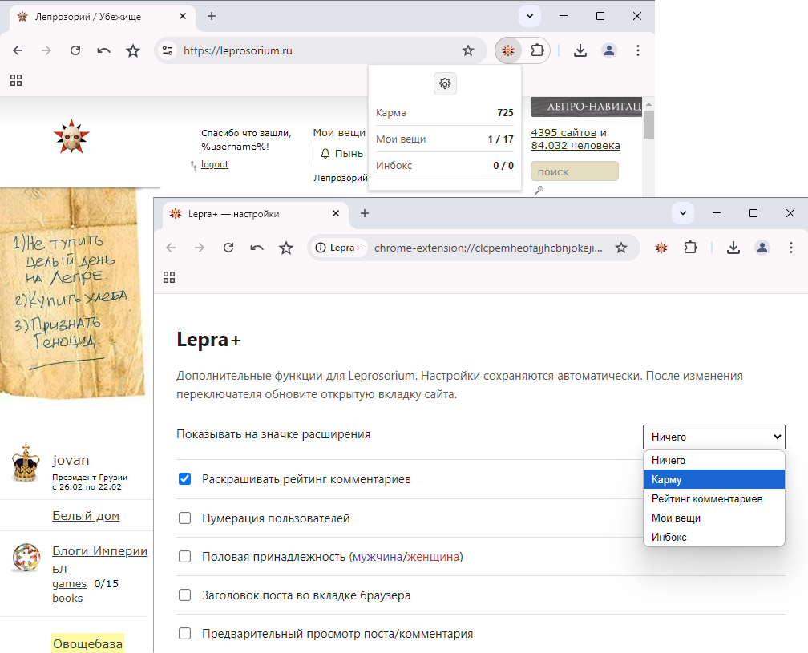

# Lepra+
**Дополнительные опции кастомизации для сайта Лепрозорий (leprosorium.ru)**

- [Основные функции](#основные-функции)
- [Установка в Chrome/Opera](#установка-в-chromium--chrome--edge)
- [Описание](#описание)

---

# Основные функции:

- **Раскрашивание рейтинга комментариев**.
- **Определение половой принадлежности пользователей** (синим цветом выделяются "мужчины", красным - "женщины").
- **Нумерация пользователей** %username% [xxxx].
- **Отображение шапки поста во вкладке браузера**.
- **Предпросмотр постов и комментариев** перед добавлением.
- **Статистика аккаунта** в pop-up (Карма, Мои вещи, Инбокс).
- **Индикация на значке расширения** (отслеживание Кармы, Рейтинга комментариев, а также новых постов и комментариев в разделах «Мои вещи» и «Инбокс»).
- **Автоматическое обновление данных** после авторизации на сайте.

---

# Установка в Chrome/Opera:

1. Откройте в адресной строке **chrome://extensions**
2. Переместите мышкой файл CRX в окно браузера со списком расширений
- в Chrome: нажмите кнопку "Установить расширение".
- в Opera: нажмите кнопку "Установить" и подтвердите "Да, установить".
3. Откройте настройки расширения, включите нужные функции и обновите вкладку с сайтом leprosorium.ru

---

# Описание:

За основу взято расширение https://github.com/Rpsl/leprosorium/ и переписано под Manifest V3.

Неактуальные на текущий момент опции удалены.

Старый API из lepropanel больше не используется.

Данные берутся из актуальных запросов, которые выполняет сам сайт:
- GET /api/users/<login>/info/?page=1
- POST /ajax/interest/moar/
- POST /ajax/inbox/moar/

Запросы выполняются из контекста открытой страницы leprosorium.ru, поэтому используются текущая авторизация и CSRF-токен сайта. Расширение не сохраняет cookies, SID или CSRF-токен.

После установки расширения и успешной авторизации на сайте leprosorium.ru нажмите иконку расширения Lepra+.

Если расширение не может получить данные, сообщение содержит конкретную причину (подсказка в popup).

---

<a href="https://leprosorium.ru/users/gits/">gits</a>
