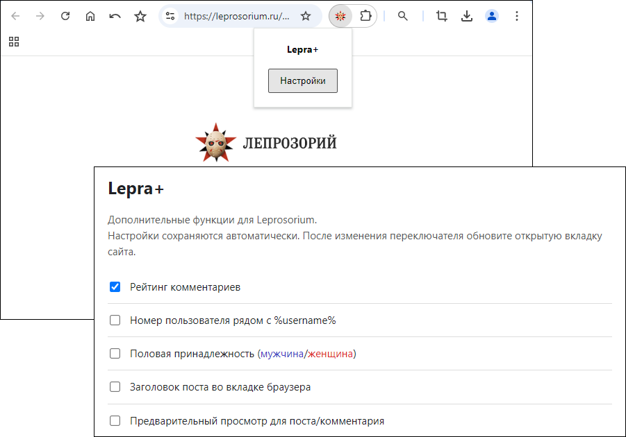

# Lepra+
Дополнительные опции кастомизации для сайта Leprosorium.ru

---
Установка в Chromium / Chrome / Edge:
-
### ZIP
1. Распакуйте архив в отдельную папку.
2. Откройте chrome://extensions
3. Включите «Режим разработчика».
4. Нажмите «Загрузить распакованное расширение» и выберите распакованную папку.
5. Откройте настройки расширения, включите нужные функции и обновите вкладку с сайтом Leprosorium.

### CRX
1. Откройте chrome://extensions
2. Переместите мышкой файл CRX в окно браузера со списком расширений.
3. Нажмите кнопку "Установить расширение".
4. Откройте настройки расширения, включите нужные функции и обновите вкладку с сайтом Leprosorium.

Основные функции:
-
- Рейтинг комментариев.
- Номер пользователя рядом с %username%.
- Половая принадлежность: синий цвет для мужчин, красный для женщин.
- Заголовок поста во вкладке браузера.
- Предварительный просмотр для поста/комментария.

---

Вдохновлено https://github.com/Rpsl/leprosorium/

Неактуальные опции удалены.

---

++ в карму <a href="https://leprosorium.ru/users/gits/">gits</a>
