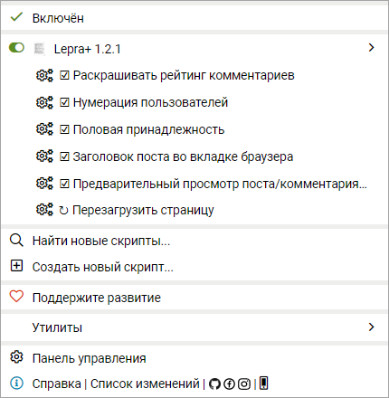
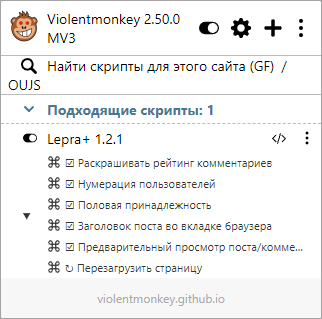

# Lepra+
**Дополнительные опции кастомизации для сайта Лепрозорий (leprosorium.ru)**

- [Основные функции](#основные-функции)
- [Установка расширения](#установка-расширения)
- [Первое использование](#первое-использование)
- [Основные изменения](#основные-изменения)

---

# Основные функции:

- **Раскрашивание рейтинга комментариев**.
- **Определение половой принадлежности пользователей** (синим цветом выделяются "мужчины", красным - "женщины").
- **Нумерация пользователей** %username% [xxxx].
- **Отображение шапки поста во вкладке браузера**.
- **Предпросмотр постов и комментариев** перед добавлением.
- **Статистика аккаунта** в pop-up (Карма, Мои вещи, Инбокс).
- **Индикация на значке расширения** (отслеживание Кармы, Рейтинга комментариев, а также новых постов и комментариев в разделах «Мои вещи» и «Инбокс»).
- **Автоматическое обновление данных** после авторизации на сайте.

---

# Установка расширения
## Chrome/Opera
#### Если конкретная сборка Chrome/Opera разрешает локальную установку CRX:
1. Откройте в адресной строке *chrome://extensions* (для Chrome) или *opera://extensions* (для Opera).
2. При необходимости включите «Режим разработчика».
3. Переместите мышкой файл **[CRX](https://github.com/longinclown/lepra_plus/releases/latest/download/Lepra_plus_chrome_opera.crx)** в окно браузера со списком расширений.
4. В Chrome нажмите «Установить расширение». В Opera нажмите «Установить» и подтвердите «Да, установить».

#### Если Chrome/Opera блокирует локальный CRX, используйте ZIP:
1. Распакуйте **[ZIP](https://github.com/longinclown/lepra_plus/releases/latest/download/lepra_plus_chrome_opera.zip)** в постоянную папку.
2. Откройте *chrome://extensions* (для Chrome) или *opera://extensions* (для Opera) и включите «Режим разработчика».
3. Нажмите «Загрузить распакованное» и выберите папку, в которой находится manifest.json

## Через загрузчик юзерскриптов (Tampermonkey/Violentmonkey)
**(только опции кастомизации сайта, без popup)**
1. Установите загрузчик юзерскриптов: **[Tampermonkey](https://www.tampermonkey.net/)** (или **[Violentmonkey](https://chromewebstore.google.com/detail/violentmonkey/jinjaccalgkegednnccohejagnlnfdag)** для Opera)
2. Нажмите **[«Установить скрипт»](https://github.com/longinclown/lepra_plus/releases/latest/download/lepra_plus.user.js)**
3. (для Opera) В настройках Violentmonkey включите опцию "Разрешить пользовательские скрипты".

  

---

# Первое использование
1. Убедитесь, что в браузере выполнен вход на leprosorium.ru. Для фонового получения статистики достаточно действующей сессии — открытая вкладка сайта не обязательна.
2. Чтобы функции кастомизации применились к странице, откройте leprosorium.ru и обновите вкладку (Ctrl+R), чтобы content script расширения подключился к странице.
3. Нажмите иконку Lepra+ — popup сразу покажет кэш (если он уже есть), а обновление запустится независимо от popup и открытых вкладок сайта.
4. При повторном открытии popup последние сохранённые данные отображаются сразу; обновление выполняется параллельно в фоне. При поступлении свежих данных значения в открытом popup обновляются автоматически.
5. Если кэш ещё пуст и расширение не может получить данные, popup показывает причину (например, "сайт не открыт", "вкладка не обновлена" или "запрос завершился ошибкой").

---

# Основные изменения:

- За основу взято расширение https://github.com/Rpsl/leprosorium/.
- Неактуальные на текущий момент опции удалены. Старый API из lepropanel больше не используется.
- Сохранены и адаптированы основные функции расширения: раскраска рейтинга комментариев, нумерация пользователей, обозначение пола, заголовок поста во вкладке браузера и предварительный просмотр постов/комментариев.
- Реализовано получение статистики двумя способами: основной — прямые авторизованные запросы из фонового service worker, резервный — через content script открытой вкладки Leprosorium. Благодаря основному способу данные обновляются, даже когда все вкладки сайта закрыты.
- Данные берутся из актуальных запросов сайта:
   - GET /api/users/<login>/info/?page=1
   - POST /ajax/interest/moar/
   - POST /ajax/inbox/moar/
- Для фоновых запросов расширение временно читает cookies текущей сессии uid и sid через разрешение cookies, получает CSRF-токен из авторизованной страницы /my/ и выполняет запросы с текущей авторизацией. Cookies, SID и CSRF-токен не записываются в хранилище расширения и не передаются сторонним сервисам. Если прямой запрос недоступен, используется резервный способ через открытую вкладку сайта.
- Добавлен popup со статистикой аккаунта: карма, непрочитанные посты и комментарии в «Мои вещи» и «Инбокс».
- Реализовано кэширование статистики в chrome.storage.local. При открытии popup последние успешно полученные данные выводятся сразу, без ожидания сетевых запросов; одновременно запускается фоновое обновление. После получения свежих данных открытый popup обновляет значения автоматически. Если запрос завершается ошибкой, сохраняются последние успешные данные и показывается ненавязчивое сообщение.
- Добавлено фоновое обновление по расписанию (раз в минуту), при запуске браузера и при изменениях вкладок Leprosorium. Благодаря прямым запросам из service worker обновление продолжает работать и при отсутствии открытых вкладок сайта, если сессия Leprosorium остаётся действующей.
- Добавлено обновление значка расширения: в настройках можно выбрать отображаемое значение (карма, рейтинг комментариев, «Мои вещи» или «Инбокс»).
- Добавлены диагностические сообщения: если данные получить не удалось, popup показывает конкретную причину и рекомендуемое действие.

---

<a href="https://leprosorium.ru/users/gits/">gits</a>
