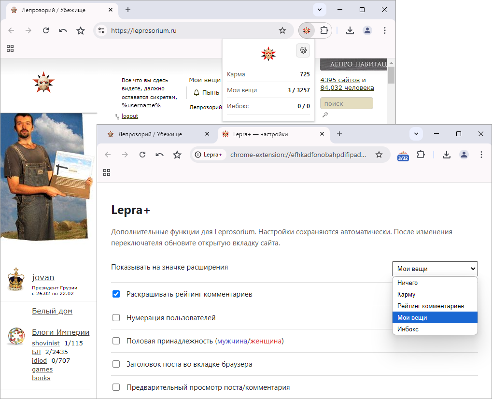

# Lepra+
**Дополнительные опции кастомизации для сайта Лепрозорий (leprosorium.ru)**

- [Основные функции](#основные-функции)
- [Установка расширения](#установка-расширения)
- [Первое использование](#первое-использование)
- [Основные изменения](#основные-изменения)

---

# Основные функции:

- **Раскрашивание рейтинга комментариев**.
- **Определение половой принадлежности пользователей** (синим цветом выделяются "мужчины", красным - "женщины").
- **Нумерация пользователей** %username% [xxxx].
- **Отображение шапки поста во вкладке браузера**.
- **Предпросмотр постов и комментариев** перед добавлением.
- **Статистика аккаунта** в pop-up (Карма, Мои вещи, Инбокс).
- **Индикация на значке расширения** (отслеживание Кармы, Рейтинга комментариев, а также новых постов и комментариев в разделах «Мои вещи» и «Инбокс»).
- **Автоматическое обновление данных** после авторизации на сайте.

---

# Установка расширения
## Chrome/Opera
#### Если конкретная сборка Chrome/Opera разрешает локальную установку CRX:
1. Откройте в адресной строке *chrome://extensions* (для Chrome) или *opera://extensions* (для Opera).
2. При необходимости включите «Режим разработчика».
3. Переместите мышкой файл [CRX](https://github.com/longinclown/lepra_plus/releases/download/lepra_plus_1.2.1/lepra_plus_1.2.1_chrome_opera.crx) в окно браузера со списком расширений.
4. В Chrome нажмите «Установить расширение». В Opera нажмите «Установить» и подтвердите «Да, установить».

#### Если Chrome/Opera блокирует локальный CRX, используйте ZIP:
1. Распакуйте [ZIP](https://github.com/longinclown/lepra_plus/releases/download/lepra_plus_1.2.1/lepra_plus_1.2.1.zip) в постоянную папку.
2. Откройте *chrome://extensions* (для Chrome) или *opera://extensions* (для Opera) и включите «Режим разработчика».
3. Нажмите «Загрузить распакованное» и выберите папку, в которой находится manifest.json

---

# Первое использование
1. После установки откройте <a href="https://leprosorium.ru">leprosorium.ru</a> и войдите в аккаунт.
2. Обновите вкладку сайта (Ctrl+R), чтобы content script расширения подключился к странице.
3. Нажмите иконку Lepra+, popup запросит статистику.
4. Если расширение не может получить данные, сообщение в popup содержит причину (например, "сайт не открыт", "вкладка не обновлена" или "запрос завершился ошибкой").
Откройте настройки Lepra+, включите нужные функции и обновите вкладку с сайтом leprosorium.ru.

---

# Основные изменения:

- За основу взято расширение https://github.com/Rpsl/leprosorium/.
- Неактуальные на текущий момент опции удалены. Старый API из lepropanel больше не используется.
- Сохранены и адаптированы основные функции расширения: раскраска рейтинга комментариев, нумерация пользователей, обозначение пола, заголовок поста во вкладке браузера и предварительный просмотр постов/комментариев.
- Реализована новая архитектура получения статистики для popup: service worker обращается к content script открытой вкладки Leprosorium, а запросы к API выполняются из контекста самой страницы.
- Данные берутся из актуальных запросов сайта:
   - GET /api/users/<login>/info/?page=1
   - POST /ajax/interest/moar/
   - POST /ajax/inbox/moar/
- Логин текущего пользователя определяется из активной страницы Leprosorium. Запросы выполняются с same-origin credentials и CSRF-токеном, полученным из DOM страницы. Используется действующая авторизация сайта. Расширение не сохраняет cookies, SID или CSRF-токен в собственном хранилище; отдельное разрешение cookies не требуется.
- Добавлен popup со статистикой аккаунта: карма, непрочитанные посты и комментарии в «Мои вещи» и «Инбокс».
- Добавлены локальное кеширование статистики и повторное использование последнего успешного результата при временной ошибке обновления. В popup отображается статус кеша и причина неудачного обновления.
- Добавлено фоновое обновление по расписанию, при запуске браузера и при изменениях вкладок Leprosorium. Фоновое получение данных возможно, пока в браузере доступна открытая вкладка сайта с загруженным content script.
- Добавлено обновление значка расширения: в настройках можно выбрать отображаемое значение (карма, рейтинг комментариев, «Мои вещи» или «Инбокс»).
- Добавлены диагностические сообщения: если данные получить не удалось, popup показывает конкретную причину и рекомендуемое действие.

---

<a href="https://leprosorium.ru/users/gits/">gits</a>
