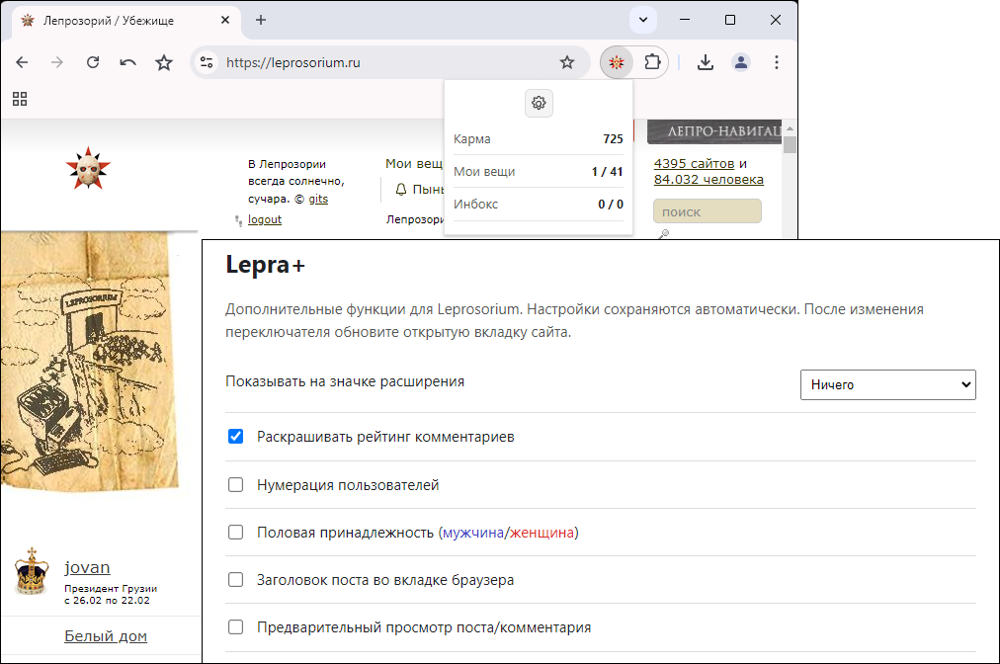

# Lepra+
**Дополнительные опции кастомизации для сайта leprosorium.ru**

- [Основные функции](#основные-функции)
- [Установка](#установка-в-chromium--chrome--edge)

---

# Основные функции:

- **Раскрашивание рейтинга комментариев**.
- **Определение половой принадлежности пользователей** (синим цветом выделяются "мужчины", красным - "женщины").
- **Нумерация пользователей** (%username% [xxxx]).
- **Отображение шапки поста во вкладке браузера**.
- **Предпросмотр постов и комментариев** перед добавлением.
- **Статистика аккаунта** в pop-up (Карма, Мои вещи, Инбокс).
- **Индикация на значке расширения** (отслеживание Кармы, Рейтинга комментариев, а также новых постов и комментариев в разделах «Мои вещи» и «Инбокс»).
- **Автоматическое обновление данных** после авторизации на сайте.

---

# Установка в Chromium / Chrome / Edge:

### CRX
1. Откройте chrome://extensions
2. Переместите мышкой файл CRX в окно браузера со списком расширений.
3. Нажмите кнопку "Установить расширение".
4. Откройте настройки расширения, включите нужные функции и обновите вкладку с сайтом Leprosorium.

### ZIP (для отладки)
1. Распакуйте архив в отдельную папку.
2. Откройте chrome://extensions
3. Включите «Режим разработчика».
4. Нажмите «Загрузить распакованное расширение» и выберите распакованную папку.
5. Откройте настройки расширения, включите нужные функции и обновите вкладку с сайтом Leprosorium.

---

Вдохновлено https://github.com/Rpsl/leprosorium/

Неактуальные опции удалены.

---

**++ в карму <a href="https://leprosorium.ru/users/gits/">gits</a>**
